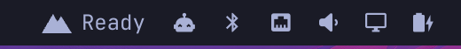
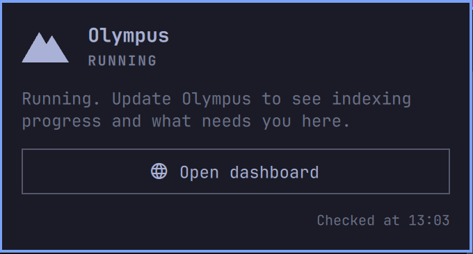

# Olympus for Omarchy

An [Omarchy](https://omarchy.org) bar widget for [Olympus](https://github.com/jamiezigelbaum/Olympus), your private second brain.





Like Omarchy's own widgets, it is icon-first. While Olympus is quiet the bar shows just the mountain. Words appear beside it only while something is happening:

| Bar | Meaning |
|---|---|
| *(mountain only)* | Running, with nothing happening. Hover for the state. |
| `Indexing 42%` | Building or refreshing the index |
| `Indexing paused` | Indexing has stalled |
| `Needs you` | Something needs you. This takes priority over indexing and is shown in your theme's urgent colour. |
| `Starting…` / `Stopped` | The engine is coming up or is off |

- **Left click** opens a panel with the detail: progress, items left, time left, and what needs you, in the dashboard's own words. The panel also has an **Open dashboard** button.
- **Right click** opens the dashboard directly.
- **Middle click** checks again.
- **Keys in the panel:** Enter or `d` opens the dashboard, `r` refreshes, Esc closes.

## Install

```bash
omarchy plugin add https://github.com/jamiezigelbaum/omarchy-olympus.git --enable
```

> **Install or update only while you're at the unlocked desktop.** The Omarchy shell reloads plugin code as soon as files change under `~/.config/omarchy/plugins/`. In Omarchy 4.0.1, a reload while the screen is locked can strand the lock screen, which then shows Hyprland's "lockscreen app died" failsafe. Check `omarchy-shell lock status` first. If it happens anyway, run `hyprctl --instance 0 eval 'hl.clear_crashed_lockscreen()'` from another TTY; the shell locks again by itself.

After `omarchy plugin update jamiezigelbaum.olympus`, run `omarchy-restart-shell` to load the new version. In Omarchy 4.0.1 the automatic reload re-creates the widget from the code it already loaded.

Move it with `omarchy bar move jamiezigelbaum.olympus`. You can change these settings for the widget:

- How often it checks Olympus. The default is every 60 seconds.
- Whether the words appear beside the icon. With the words off, only the coloured mountain shows.
- The path to the `olympus` command. The default is `~/.local/bin/olympus`.

## Requirements

- Olympus installed for your user on Linux (`olympus engine status` works in a terminal).
- For progress and "Needs you", an Olympus version with `olympus engine status --brief`. Older versions show only running or stopped.

## Privacy

The widget runs inside the Omarchy shell, so it is kept deliberately small:

- **It runs only the `olympus` CLI**, as `engine status --brief`, `engine status` and `dashboard`. It never opens Olympus's files, socket or secrets, and makes no network requests.
- **It keeps very little from the status output:** the state, the progress numbers and the dashboard's own sentences, held only in memory. Nothing is logged or written to disk.
- **It never reads the output of `olympus dashboard`.** That command opens a private, single-use owner link in your browser.

## Development

The plain-words logic lives in `Status.js`. Its tests run under Node:

```bash
node --test tests/status.test.js
```

`omarchy plugin validate .` checks the manifest on an Omarchy machine.

## License

MIT
